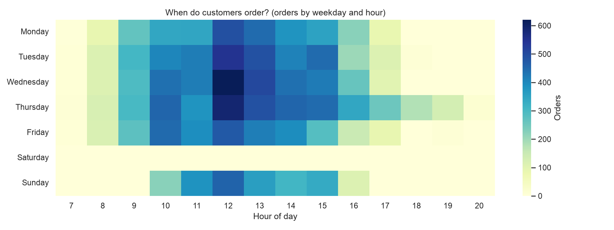
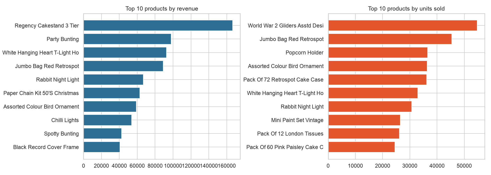
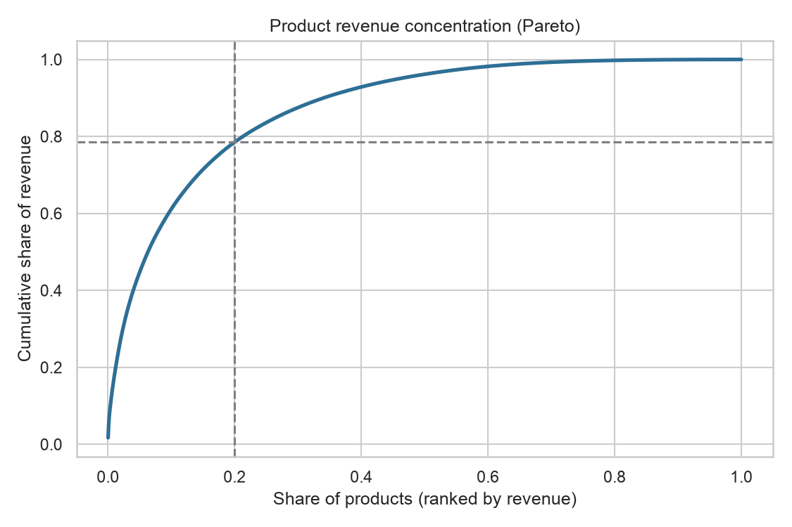
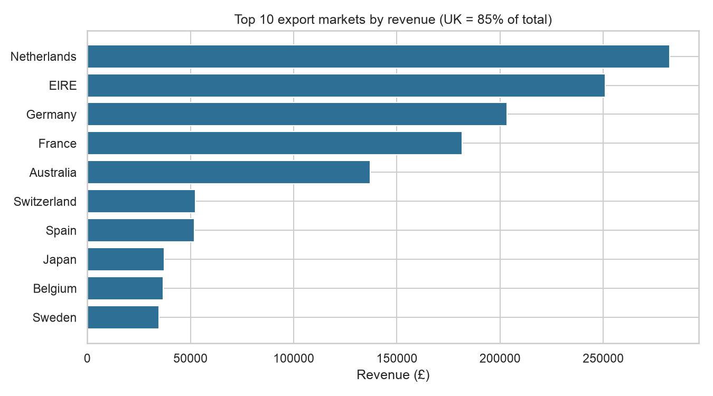
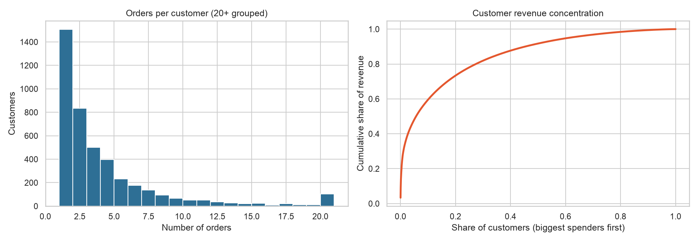
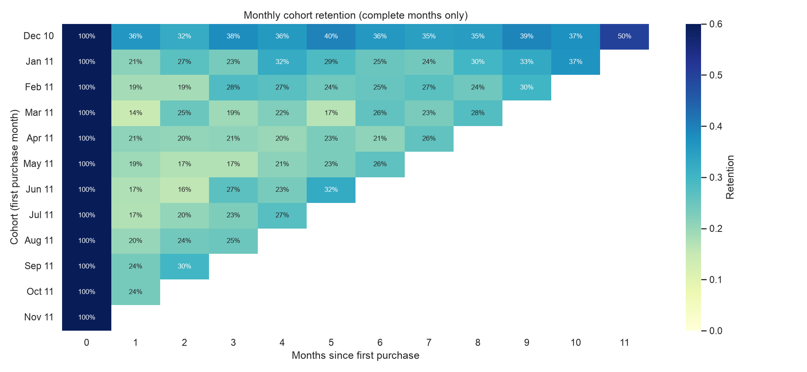
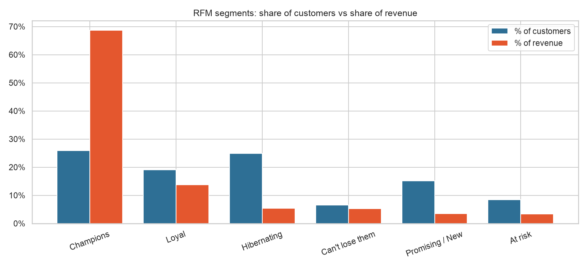
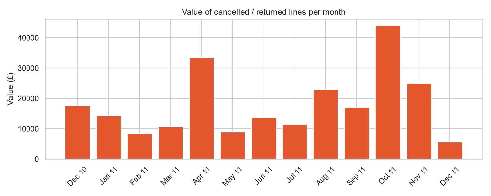

# E-Commerce Sales & Customer Retention Analysis

Analysis of one year of transactions from a UK online gift retailer, turning raw data into business recommendations to grow sales and retain customers.

**Tools:** Python, Pandas, NumPy, Matplotlib, Seaborn

## Project overview
The retailer wants to grow revenue and keep customers coming back. This project cleans a messy transaction log, then answers four questions: **what sells, when it sells, who keeps buying, and who is about to leave.**

## Dataset
- **Source:** [UCI Online Retail dataset](https://archive.ics.uci.edu/dataset/352/online+retail)
- **Content:** 541,909 transaction lines, 1 Dec 2010 to 9 Dec 2011, currency £
- **After cleaning:** about £9.7M net revenue, 4,321 identified customers

## Business questions
1. **Sales:** how does revenue change over time, and when do customers buy?
2. **Products:** which products drive revenue?
3. **Customers:** how many come back, and how much revenue do they bring?
4. **Retention:** who is at risk of leaving, and what should the business do?

## Methodology
1. **Data-quality audit**: measured missing IDs (25% of rows), cancellations, invalid quantities and prices, and duplicates before changing anything.
2. **Cleaning** (every step logged): separated cancellations into a returns table, removed zero/negative quantities and prices (stock adjustments), dropped duplicates, removed non-product lines (postage, fees, manual entries), and removed orders cancelled afterwards (including two bulk orders of ~75K and ~81K units reversed within minutes).
3. **Feature engineering**: revenue, month, weekday, hour.
4. **Analysis**: sales trends, product Pareto, geography, customer behaviour, cohort retention, RFM segmentation, returns.

## Key findings

### Sales and timing
- Revenue peaks in **November 2011 (£1.43M)** and is lowest in April 2011 (£488K). Revenue roughly doubles from August to November, a pre-Christmas peak.
- Average order value stays between **£401 and £562** in every full month, so growth comes from **more orders**, not bigger baskets.
- About **75% of revenue** is placed between 10:00 and 15:59. There are **no orders on Saturdays**, and Sunday is weak (8%).




### Products
- The top 20% of products generate **79% of revenue**. 982 products earned under £100 in total.
- #1 is the **Regency Cakestand 3 Tier (£166K)**. Volume leaders are cheap items (e.g. World War 2 Gliders: 54.7K units but only £14K), so selling many units does not mean earning the most.




### Geography
- The UK is **85% of revenue**. Export orders are larger (AOV £809 vs £466), but the Netherlands and EIRE are driven by very few customers (9 and 3), which points to wholesale-style buying and a concentration risk. Germany (94 customers) and France (87) have the broadest export bases.



### Customers and retention
- **65.1%** of identified customers ordered more than once and generate **93.4%** of revenue. The top 20% of customers produce 73.4%.
- Repeat and one-time customers have a similar AOV (£377 vs £362), so loyalty is about **order frequency**, not basket size.
- Only **about 20%** of a cohort orders again in the month after its first purchase. New-customer acquisition fell **59% from January to August 2011**.




### RFM segments
- **Champions** (26% of customers) generate **69% of revenue**.
- **Can't lose them + At risk**: 649 customers holding **£705K (8.6% of revenue)**, the best win-back list.
- **Promising / New**: 653 customers with about one order, the group where a second-order nudge matters most.



### Returns
- Cancelled product lines are worth about **£233K (~2.4% of net sales)**. The most-cancelled products are also top sellers (Regency Cakestand, White Hanging Heart T-Light Holder).



## Recommendations
1. **Second-order nudge** in the first weeks after a first purchase. KPI: month-1 retention (baseline ~20%).
2. **Win-back campaign** for "Can't lose them" and "At risk" customers.
3. **Protect Champions**: early access, loyalty perks, hero products always in stock.
4. **Plan for Q4** by August, and send campaigns on weekday mornings.
5. **Test off-season acquisition** (Jan-Aug acquisition fell 59%).
6. **Review the long product tail** and keep hero products stocked.
7. **Investigate cancellations** of the top-selling products.
8. **Account management** for large export buyers, marketing for Germany and France.
9. **Encourage account creation** at checkout (25% of rows have no customer ID).

## Limitations
- Customer analysis covers identified customers only (about 75% of rows).
- Cancellation matching is approximate (same customer, product, quantity).
- Dec 2011 is a partial month, and the Dec 2010 cohort includes pre-existing customers.
- Only 12 months of data, so seasonality is seen for one year.

## How to run
```bash
git clone <your-repo-url>
cd online-retail-analysis
python3 -m venv .venv
source .venv/bin/activate
pip install -r requirements.txt
jupyter notebook notebooks/
```
Place `Online_Retail.xlsx` in the `data/` folder (see the dataset link above).
